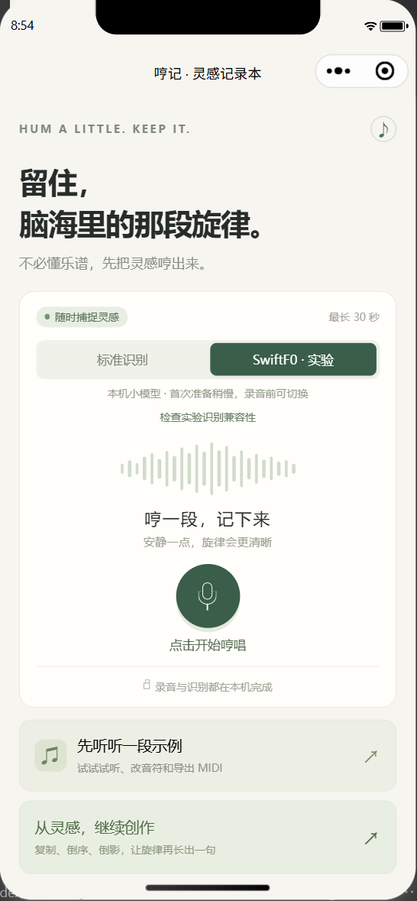

# SwiftF0 手机兼容适配 · 2026-11-03

> **后续修复：** 手机给出了 `model path invalid` 后，模型加载已改为 JS 内置字节 → 微信本地文件 → 完整本地路径，当前版本为 `0.3.0-wechat-v3`。当前加载方式见 [模型路径修复记录](2026-11-03-SwiftF0模型路径修复.md)；以下保留本轮声学适配与 v2 验证记录。

用户反馈 vivo X200 Ultra 在真机调试和扫码预览中均未能运行上版实验识别。上版将多类失败统一提示为“实验识别不可用”，没有保留完整原生错误，**目前不能据此认定该手机不支持，也不能确定原失败发生在模型导入还是推理阶段**。

本轮直接完成一版减少导入限制的本地适配，并加入可复制的诊断报告。新模型仍需在用户手机上验证；桌面等价性与模拟器诊断通过，不等于 vivo 真机已修复。

## 手机如何复测

1. 从当前工程重新生成预览，避免打开昨天的旧预览。首页选择 **SwiftF0 · 实验**。
2. 点击新增的 **检查实验识别兼容性**。检查使用内置数字和合成测试信号，不调用麦克风、不读取个人录音、不上传数据。
3. 检查先调用 `getInferenceEnvInfo` 收集环境信息，再实际执行一个只有 Add 的小模型，最后加载 SwiftF0 并推理一段测试信号。环境查询失败不会直接阻止后续真实推理检查。
4. 若通过，再录 3～10 秒哼唱，确认编辑页标记为 **SwiftF0 实验**。
5. 若失败，点击 **复制报告**，把文字发回本聊天。报告包含微信/系统/基础库版本、模型哈希、失败的检查与原始错误。只在用户点击时复制，不自动发送。

报告里的 `failedCheck: engine` 表示最小模型也未运行成功，还需依据原始错误区分接口、环境或文件导入问题；它不证明硬件能力不足。`engine: passed` 而 `failedCheck: model` 表示基础推理成功，问题已缩小到 SwiftF0 模型加载、输出或运行。

识别时的回退仍保留原音、标准模式结果和原始诊断；编辑页可以点“查看识别诊断”。旧记录没有完整错误时，会引导到首页重新检查。取消、静音、无效录音仍不会被掩盖为引擎回退。



## 本轮做了什么

- 将频谱前处理移到 JavaScript：同样的 1024/2048/512 点 Hann 窗、FFT 和官方对数频率滤波器；计算分批让出执行，支持取消。正常 16kHz 录音不重采样。
- 原生模型只保留 SwiftF0 的神经网络。输入固定为 `features: [1,3,128,152]`，并提供有效帧 mask；保持每块 128 帧及前后最多 12 帧上下文。
- 所有卷积统一为二维卷积，模型改成 ONNX opset 11、IR 7。原生图不再包含动态 Shape/Gather、频谱 MatMul、FFT、Log、Sqrt 或 Pad 等前处理节点。
- 每层卷积后清零无效补齐帧，防止卷积偏置污染末尾音符。有效部分与原先变长网络的最大 logits 差异约 `0.00000215`。
- **没有更改训练权重、重新训练或量化**。原生模型从 1,089,152 字节降为 **82,484 字节，约 80.6 KiB**；另有 81,105 字节的 JS 频率滤波系数。旧的波形模型已移出小程序包，保留在本地工作备份中。
- 模型由原生 API 直接读取随包路径，不依赖文件系统是否允许读取代码包资源。首页仍不加载识别实现、频谱系数或初始化模型。
- 模型会话继续复用，加载/推理超时、取消和页面卸载会释放资源。诊断检查期间禁用录音、切换模式和导航入口，避免并发占用。

这版以兼容性为优先。频谱计算转到 JS 后，不能仅凭模型更小就宣称手机推理更快；手机上的耗时、内存、耗电仍待测。

## 验证

`npm test` **171 项命名检查通过**，其中 29 项为实验识别与诊断检查。覆盖固定窗口及有效帧、取消、会话复用、超时、无效输出、接口缺失、基础引擎与具体模型区分、错误保存、用户确认后复制，以及原有录音、编辑、创作、音频/MIDI 导出和性能回归。

用上一轮冻结的 **40 段真人录音、346 个模型分块**验证生产 JS 频谱、桌面 ONNX Runtime 中的实际 CNN 输出、生产 JS 音符分割和 MIDI 回读：

- 音高最大差异小于 **0.002 音分**，置信度阈值判断差异为 0 帧。
- 1,442 个分割音符的数量与取整音高保持一致。39 段的边界完全一致；`vocadito_13` 的一个换音边界移动 1 帧，即 16ms。编辑格式取整后差异约 15.6ms。
- 编辑器过滤原有 29 个极短片段，最终仍为 1,413 个音符。40 段均通过无重叠、规范化不改写与独立 MIDI 回读检查。
- Vocadito 的音符 F1（50ms 起音容差）仍为 **67.83%**，同时约束结束时间的 F1 仍为 **54.70%**，与上版编辑器适配结果一致。
- 桌面 JS 频谱提取耗时中位数约 121ms；这是桌面 Node 测量，不能推算为手机结果。

模拟器真实检查已确认 `getInferenceEnvInfo` 和 `createInferenceSession` 返回“开发者工具暂时不支持此 API 调试”，并被报告为 `engine / load / SWIFT_NATIVE`；没有误报成模型已运行成功。模拟器不能验证手机原生算子兼容性。

可机读结果见 [SwiftF0兼容适配验证.json](SwiftF0兼容适配验证.json)。上一轮记录见 [2026-11-02 实验识别](SwiftF0实验识别.md)。

## 如果原生路线仍不能用

| 路线 | 音频可保持本地处理 | 主要工作与限制 |
| --- | --- | --- |
| 本版固定尺寸原生 CNN | 可以 | 已实现，等待手机新预览和具体错误验证；保留现有编辑和分享功能 |
| SwiftF0 转 TensorFlow.js | 可以 | 需要转换模型、接入插件/后端、处理分包及性能；可绕开当前原生 ONNX 导入器，但不能保证免于其他兼容问题 |
| 服务器运行原版 SwiftF0 | 需要上传录音 | 沿用已验证的 Python/ONNX 实现，手机仅收音符；需要 HTTPS 服务、明确上传操作及持续服务资源，受网络影响 |

建议先测试本版。如果最小模型也失败，优先评估 TensorFlow.js 本地推理；如果最小模型成功，仅 SwiftF0 失败，继续针对报告中的模型错误处理。需要快速扩大设备兼容范围时，再考虑服务器方案。

[TensorFlow.js 官方微信插件](https://github.com/tensorflow/tfjs-wechat)提供小程序接入方式，需要在后台添加插件并按需引入 npm 依赖。[vivo 互联网大前端团队的工程实践](https://www.cnblogs.com/vivotech/p/19073001)也采用过微信原生推理与 TensorFlow.js 组合。这些资料证明替代路线存在，不代表它们已经验证过本项目的 SwiftF0 模型。

不建议仅为解决运行问题直接换成 Basic Pitch：模型本身的识别效果与运行框架兼容性是两个问题；上一轮同批录音中，Basic Pitch 的表现也未超过 SwiftF0。

## 模型重建与许可

版本 `0.3.0-wechat-v2`，仍固定上游提交 `d1ba77fe5331310b778ebe126b6cb3656d41d24f`，原始模型 SHA256 为 `6385e8c2ebc3872e82c9ff5946228de44cd3be77a750ea53698b7dbfe94b0a22`。

本版 CNN SHA256：`4b2a907dcc1dcdce8f0cbf2232189c886abeac2b6c739b1a692e692d2abb1407`。

使用原模型与独立 Python 环境中的 `onnx==1.20.1`、`onnxruntime==1.24.4`、`numpy==1.26.4`：

```powershell
python tools/export-swift-compat.py /path/to/original/model.onnx --output /path/to/build
```

输出包括 CNN、最小检查模型、滤波系数及元数据。`--include-oracle` 只供桌面对照，生成的频谱 oracle 不应放入小程序包。运行小程序或 `npm test` 无需 Python。

SwiftF0 模型和移植算法继续遵守 Lars Nieradzik 的 MIT 许可，完整声明见 [LICENSE.swift-f0.txt](../miniprogram/models/LICENSE.swift-f0.txt)。项目自身保持 Apache-2.0。本轮没有接入云识别、上传用户录音或发布小程序。
