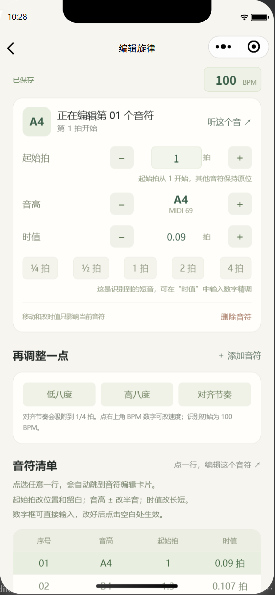

# SwiftF0 短音与重复音优化 · 2026-11-03

用户已确认本地模型路径修复后手机可正常运行，本轮重点处理“音符分不开或漏掉短音”。这是基于既有 SwiftF0 模型的前后处理优化，没有重新训练、量化或替换模型，也没有更改已跑通的本地模型文件加载方式。

新录音在 **SwiftF0 · 实验** 模式下自动使用 `humming-notes-v2` 处理。旧灵感不自动重新识别；原始哼唱文件仍保存原波形与原音量。

## 改了什么

1. **针对清晰短促换音调整分段。** 平常维持原有 80ms 音符开销；只在前后音高稳定、至少相差一个半音、置信度高且换音足够陡时，局部降低新音符开销。连续滑音和普通颤音不作为这种起音线索。
2. **同音重复采用双重证据。** 同时出现至少 6dB 的局部音量谷、至少 0.08 的置信度回落，而且前后音高一致时，才补充分段。保留两次起声之间的小休止，限制最短片段长度。单纯音量起伏不触发额外重复音检测。
3. **短音不再在保存环节被无条件丢掉。** 公共最小时值从 0.125 拍扩展到 **0.0625 拍**；识别出的短片段还需满足平均置信度至少 0.85、音高偏差足够小。初始 100 BPM 下，原先常被过滤的 48–64ms 稳定短音现在可保留；更短或不稳定的碎片仍过滤。
4. **编辑、创作、试听和 MIDI 同步支持短音。** 数值时值输入、音高/起点移动、撤销重做、保存再进入、复制/逆行和导出不会把短音拉长回 0.125 拍。拖动吸附仍沿用原网格，精细修改可使用数值输入。短音编辑卡片会显示精调提示。
5. **补偿过轻的哼唱。** 仅对低于约 0.02 峰值、且有足够周期性证据的录音进行有上限的增益补偿；较大直流偏移会先去除。正常音量不额外归一化，随机噪声不会仅因音量小而被自动放大。处理分批让出执行并支持取消。

[SwiftF0 官方说明](https://github.com/lars76/swift-f0)指出模型不自动归一化极轻录音。这里的周期性检查、增益上限与短音/重复音策略是哼记增加的处理，不是新的神经网络能力。

## 真人录音验证

使用完整的 **40 段 Vocadito、29 位歌手**。35 段、24 位歌手用于开发与参数选择；另外 5 段、5 位歌手不参加参数搜索。两组歌手不重叠，但这 5 段都为英语，且迭代时已查看过汇总指标，因此最终标记为**复核集**，不宣称是新的盲测。

每条录音沿用开头最多 30 秒，单声道 PCM16、16kHz。人工标注 A1/A2 分别评分后在录音内平均，再按歌手平均，避免多次录音的歌手权重偏大。评分保持原时间与绝对音高，起音容差 50ms，不做乐谱时间对齐、逐条调参或调性吸附。

候选搜索只读取开发集标签。普通音符开销、候选音高网格、置信度相关分段偏置、重复音与稳定换音策略共检查 70 个组合；会把单纯振幅颤动切成重复音的候选被构造样例排除。最终参数在生产回放前固定。

最终回放使用**生产 JavaScript 的音频处理和频谱、桌面 ONNX Runtime 实际执行的同一 CNN、生产 JS 的解码与音符处理、实际 MIDI 编码器及独立解析器**。原生模型输入逐块做哈希核对。手机端浮点与耗时仍可能不同，本轮未在手机上采集新的准确度或性能数据。

### 普通音量：40 段合计，包含开发集

| 指标 | 原 SwiftF0 v3 处理 | 本轮处理 |
| --- | ---: | ---: |
| 音符 F1，兼顾漏音与误分 | 68.26% | 69.01% |
| 音符精确率 | 75.09% | 74.73% |
| 音符召回率 | 63.42% | 65.00% |
| 150ms 以内短音召回率 | 41.12% | 45.62% |
| 同音重复对召回率 | 29.82% | 32.57% |
| 同时约束结束时间的音符 F1 | 54.80% | 55.85% |

这些数值是 F1、精确率或召回率，不能混称“识别正确率”。更容易保留短音也会带来少量误分：整体精确率下降约 0.36 个百分点。按歌手成对重采样的普通音量 F1 增量 95% 区间约为 **−0.13～+1.70 个百分点**，包含 0，不能据此宣称统计显著或对所有人都有提升。

### 5 位独立歌手复核

| 指标 | 原处理 | 本轮处理 |
| --- | ---: | ---: |
| 音符 F1 | 66.97% | 67.62% |
| 150ms 以内短音召回率 | 32.18% | 36.21% |
| 同音重复对召回率 | 21.58% | 23.74% |
| 同时约束结束时间的音符 F1 | 50.73% | 50.49% |

5 位中有 2 位 F1 提升、2 位持平、1 位下降。样本很小，普通音量下结束时间 F1 略降约 0.24 个百分点，不能声称每项都改善。此结果满足预先固定的“不降低复核集音符 F1、结束时间 F1 降幅不超过 1 个百分点”的启用门槛，没有据此继续逐条调参。

### 人工降低音量的压力测试

将同一批真人录音统一降低 36dB，比较两条处理流程。这是**人工电平衰减**，不能等同于新录制的轻声、气声或嘈杂环境数据。

- 40 段音符 F1：42.26% → 68.16%；无可识别音符的录音由 2 段变为 0 段。
- 5 位复核歌手：46.61% → 67.24%。
- 增益检测不使用人工音符标签，原始录音没有被修改。

## 软件与界面验证

- `npm test` 共 **190 项命名检查通过**，包含新增 13 项准确度专项检查和真实编辑函数的短音生命周期检查，另含原有模型文件、录音权限、播放、导出与性能回归。
- 实际生产回放共 160 个处理案例：40 段 × 普通/降低音量 × 原/新处理。158 个非空结果通过规范化不改写、无重叠和独立 MIDI 回读；另外 2 个是原流程在低音量下返回无音符，作为失败计入指标，没有删去。
- 专项构造样例验证：64ms 短促换音与清晰半音回转能独立保留，连续滑音与普通颤音不强行增加起音，短片段须高置信且稳定，低音量噪声不自动放大，取消有效。
- 微信模拟器中实际载入 0.08/0.107/0.08 拍样例，把第一音精调为 0.09 拍，保存并导出。独立回读实际写出的 MIDI，三个音的音高、起点与时值均保留，误差不超过一个 tick。临时灵感和 MIDI 已清理。
- 新模型文件传输与 CNN 权重未改变，仍使用用户已确认可运行的 `0.3.0-wechat-v3` 本地路径方案。普通首页不加载实验识别实现。额外处理在录音结束后执行；桌面测试不能替代手机延迟或耗电测量。

可机读摘要、分组结果与区间见 [SwiftF0识别优化验证.json](SwiftF0识别优化验证.json)。

## 来源与复现

- 数据：[Vocadito 论文](https://arxiv.org/abs/2110.05580)，Rachel Bittner 等；数据与双人标注按其自身许可使用，本工程包不包含原始音频或标注。
- CNN SHA256：`4b2a907dcc1dcdce8f0cbf2232189c886abeac2b6c739b1a692e692d2abb1407`，与优化前一致。
- 固定样本清单、原始输入/标注哈希、搜索结果与生产回放中间结果保存在本地 `work/swift-accuracy-20261103`；部署代码不读取数据集或评测标签。
- `swift-f0-note-config.js` 保存固定参数，`swift-f0-preprocess.js` 负责音量处理，`swift-f0-notes.js` 负责稳定换音与同音重复，`swift-f0-core.js` 执行动态规划和编辑格式转换。回归入口仍为 `npm test`。

SwiftF0 模型和原分段算法遵守 MIT；项目自身继续采用 Apache-2.0。本轮没有上传用户录音或发布小程序。
