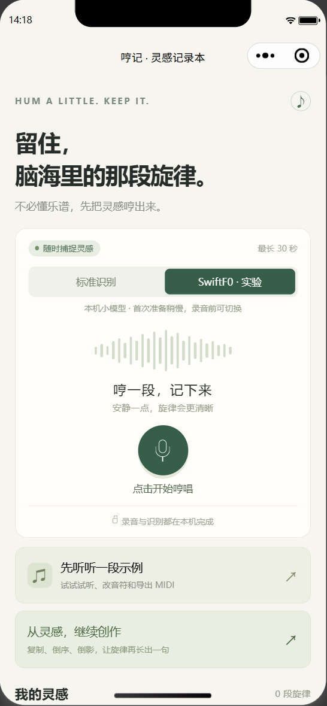
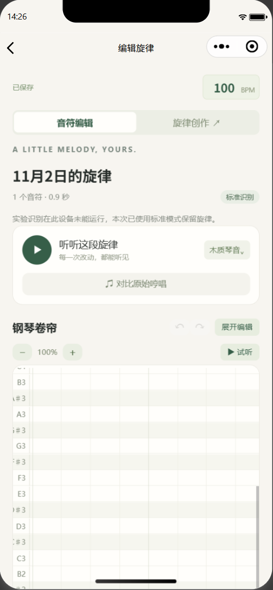

# SwiftF0 实验识别 · 2026-11-02

> **2026-11-03 更新：** 手机反馈后已改为固定尺寸 CNN 与 JS 频谱前处理，并加入一键诊断。当前用法与模型大小以 [手机兼容适配记录](2026-11-03-SwiftF0兼容适配.md) 为准；以下保留为 11 月 2 日版本的历史验证记录。

首页录音卡片新增“标准识别 / SwiftF0 · 实验”开关。标准模式继续使用现有 YIN；实验模式使用随包 SwiftF0 0.3.0 模型和对应的官方音符分段算法。识别、原音保存与试听都在设备本地完成，没有音频上传或后端服务。

本版已完成桌面算法对照、自动化回归和微信模拟器回退测试。**手机原生模型加载、算子兼容性、耗时及内存尚未实测**，因此保留实验标记和标准模式。

## 使用

1. 在首页选择 **SwiftF0 · 实验**，再开始哼唱。初次安装默认标准模式；之后会记住所选模式。录音或识别中不能切换。
2. 建议先录 3～10 秒清晰的单声部哼唱，再测试较长录音；上限仍为 30 秒。首次使用需要初始化本机模型，页面会显示准备模型、识别音高、整理音符等阶段及进度。
3. 识别期间可以点击“取消识别”。取消会释放原生推理会话，停止后续保存和页面跳转。
4. 成功进入编辑页后，看旋律标题下方的来源标记：**SwiftF0 实验** 才代表本次确实使用实验引擎。音符可继续拖动、改时值、试听、创作及导出 MIDI/WAV。
5. 若接口缺失、模型加载失败、原生推理出错、输出异常或超时，会提示回退，使用标准识别处理同一录音，并将选项切回标准。编辑页显示“标准识别”和回退说明，保存记录也标明实际引擎。静音、无效录音和用户取消不触发回退。

微信开发者工具当前直接返回：`createInferenceSession:fail 开发者工具暂时不支持此 API 调试，请使用真机进行开发`。模拟器因此会走标准模式回退，不能用它判断 SwiftF0 的音高准确率或手机性能。需要用开发者工具的“预览”或“真机调试”在手机上亲自完成录音授权和测试。





## 实现与性能边界

- 使用微信原生 `wx.createInferenceSession`，CPU、float32，不启用量化或 NPU。原生接口依赖微信客户端及基础库支持；单凭 API 名称存在不能判定设备可运行模型。
- ONNX 随小程序代码包提供，**1,089,152 字节（约 1.04 MiB）**，没有首次联网下载。它增加代码包下载体积；首页不加载识别实现或初始化模型，首次实验识别才创建会话。
- 每次推理处理 128 个 16ms 核心帧，前后各保留最多 12 帧上下文，拼接时裁去上下文。正常 16kHz 录音无需重采样；其他采样率用带抗混叠的重采样转换为 16kHz。
- 音符分割按原版动态规划，循环分批让出 JS 执行，支持取消。模型会话可复用；取消、异常和页面卸载会释放。模型准备上限 20 秒，每块推理上限 15 秒，超时转入回退。
- 不做节拍估计，仍按初始 100 BPM 将秒数转换为拍数。实验识别不会将音符起点强行吸附到 1/8 拍网格。
- 为满足编辑器既有时值范围，短于 0.125 拍的片段会丢弃；超过 32 拍的持续音分成几段，保留总体起止时间。音高落到最近半音，受编辑器 A0～C8 音域限制。
- 桌面对照与原生接口 mock 不能证明手机端速度、耗电或兼容性。尚未提供手机耗时数字，也未将实验模式设为默认。

## 验证结果

### 真人录音与官方实现对照

继续使用上一轮冻结的 **同一批 40 段真人录音**：24 段 Vocadito、16 段 HumTrans，不据此重新调参。清单 SHA256 为 `71b87329b298882a3bd3baa5bff54de8b3a45019db95e1d5ddcb3c44cf511fc4`。

用桌面 ONNX Runtime 实际执行适配模型的 **346 个分块**，将原生输出交给本版生产 JavaScript 解码、分割、保存格式转换和 MIDI 写出。此处验证模型与 JS 的衔接，未冒充微信手机推理。

- 拼接后的音高与原版最大差异小于 `0.000001` 音分，置信度阈值判断差异 0 帧。
- 编辑器适配前，**1,442 个音符**的数量、起点、终点与取整音高和官方分割一致。
- 编辑器适配丢弃 29 个极短片段，最终 1,413 个音符。40 段均通过无重叠、规范化不改写和独立 MIDI 回读检查，回读误差不超过一个 tick。

| Vocadito，24 段，双标注分别评分后平均 | 音符 F1（起音 50ms） | 同时约束结束时间 F1 |
| --- | ---: | ---: |
| 标准模式，上一轮冻结结果 | 42.93% | 32.24% |
| 官方 SwiftF0 0.3.0 | 68.57% | 55.45% |
| 本版 SwiftF0，编辑器适配后 | 67.83% | 54.70% |

指标不是识别正确率百分比，也不代表对任意录音都达到这个水平。时值下限造成约 0.74 个百分点的音符 F1 下降，已单独记录。HumTrans 的参考主要是乐谱时间，不能据此宣称真人演唱的起止对齐或绝对八度准确；它保留为单独的顺序诊断队列，不混进上述结果。

可机读摘要见 [SwiftF0实验验证.json](SwiftF0实验验证.json)。

### 软件与界面

`npm test` 共 **163 项命名检查通过**，包括新增 21 项实验模式检查和原有录音权限、编辑、创作、WAV/MIDI 导出、性能回归，另含 2,712 个 YIN 帧的逐值对照。

新增检查覆盖模型及常量一致性、启动延迟加载、重采样、休止和重复同音分段、短音与长音、模型复用、加载/推理超时、旧回调隔离、取消、无效输出，以及实际页面处理函数的保存/回退/导航。原生推理会话在 Node 测试中是受控 mock。

微信模拟器验证了开关与持久化，并用 Vocadito 第 36 段开头的一秒人声走实际录音后处理函数：原生接口不支持 → 标准 YIN → 保存原音与音符 → 编辑页明确显示回退。该轮产生的测试记录和 WAV 已清理。未调用麦克风，也未发送文件或发布小程序。

## 模型来源、许可与重建

来源是 [lars76/swift-f0](https://github.com/lars76/swift-f0)，版本 **0.3.0**，固定提交 `d1ba77fe5331310b778ebe126b6cb3656d41d24f`。模型、解码及分段算法采用 MIT，完整声明见 [LICENSE.swift-f0.txt](../miniprogram/models/LICENSE.swift-f0.txt)。项目自身继续采用 Apache-2.0。

原模型下载地址：[固定版本 model.onnx](https://raw.githubusercontent.com/lars76/swift-f0/d1ba77fe5331310b778ebe126b6cb3656d41d24f/swift_f0/model.onnx)。

| 文件 | SHA256 |
| --- | --- |
| 上游原模型 | `6385e8c2ebc3872e82c9ff5946228de44cd3be77a750ea53698b7dbfe94b0a22` |
| 随包适配模型 | `07d86f79b904bc35443cf0448c67717ea120f28584fd2f8c27780ddcf7950cc5` |

未更改神经网络权重，也未重新训练或量化。适配移出 float64 音高解码，保留 float32 音高/有声 logits；折叠常量 FFT 与滤波表；将等价的 Reduce、Shape、Reshape 表达转为 opset 13、IR 8，移除未使用的自定义域和初始化量。解码和官方全局音符分割移植为 JavaScript。模型常量同时提供 JSON 溯源文件与微信可加载的 JS 模块，两者在测试中逐值核对。

可选重建工具为 [export-swift-model.py](../tools/export-swift-model.py)。在独立 Python 环境中安装 `onnx==1.20.1`、`onnxruntime==1.24.4`、`numpy==1.26.4`，然后执行：

```powershell
python tools/export-swift-model.py /path/to/original/model.onnx --output /path/to/build
```

该工具校验原始模型 SHA256，并验证 1/2/30 秒音频的输出等价性。使用上述版本已重建出与随包模型 SHA256 完全一致的文件。运行小程序或 `npm test` 无需安装 Python。

原生 API 参数依据：[微信 createInferenceSession](https://developers.weixin.qq.com/miniprogram/dev/api/ai/inference/wx.createInferenceSession.html)、[InferenceSession.run](https://developers.weixin.qq.com/miniprogram/dev/api/ai/inference/InferenceSession.run.html)。
