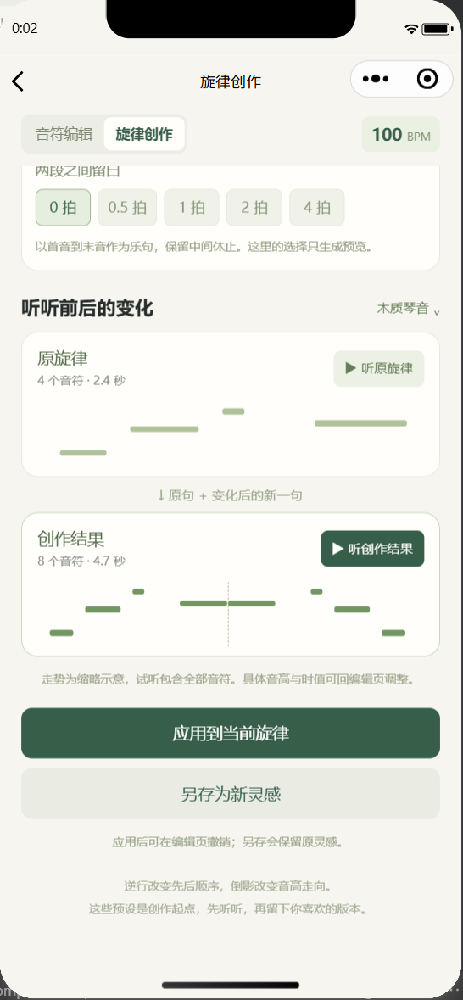
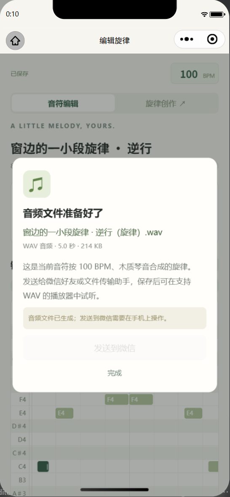

# 旋律创作与音频分享

完成日期：2026-10-25。本轮新增独立创作页与 WAV 文件分享，沿用本地处理与保存。

## 使用方式

首页点击“从灵感，继续创作”，可选择已有灵感；没有记录时可以用示例开始。也可从编辑页顶部的“旋律创作”分页进入，处理当前旋律。

创作页默认选择“逆行”及“复制变化后接在末尾”，对应“整体复制后反转”的用法。选择预设后，先试听原旋律和创作结果；此时不会改写原记录。可调整两段间留白，或切换为“只保留变化后的整段”。

- 从编辑页进入时，“应用到当前旋律”把结果放回编辑器，并保留一步撤销。
- “另存为新灵感”保留原记录，打开新记录继续编辑。原始哼唱也会复制为新记录自己的文件，避免删除任意一条灵感时破坏另一条录音。
- 从首页独立进入时，选择来源并另存；也可以回到来源的编辑页。

编辑页底部保留原有“导出 MIDI”，并新增“分享音频文件”。有录音时可选：

| 选项 | 内容 | 速度/音色 |
| --- | --- | --- |
| 当前旋律音频（WAV） | 把当前编辑后的音符合成为音频 | 当前 BPM 与所选木质琴音/柔和正弦 |
| 原始哼唱录音（WAV） | 已保存的原始哼唱 | 保持录音原速，不受后续音符编辑影响 |

文件准备后展示名称、时长和大小，用户点击“发送到微信”选择接收方。WAV 为标准音频文件；接收端内置预览能力依平台而异，也可保存后用支持 WAV 的播放器打开。开发者工具可以生成文件，文件转发需在手机微信中验证。本轮没有实际发送给任何联系人。

## 调研与预设选择

乐句发展可以从短小动机出发，通过重复、音程方向变化、时值变化与片段组织形成新材料。Open Music Theory 将倒影、逆行、节奏伸缩等列为动机变化方式；Puget Sound 的教材进一步区分旋律倒影、时值增减与逆行。[Open Music Theory：Foundational Concepts](https://viva.pressbooks.pub/openmusictheory/chapter/foundational-concepts/)、[Music Theory for the 21st-Century Classroom：Melodic Alteration](https://musictheory.pugetsound.edu/mt21c/MelodicAlteration.html)。

本轮的产品选择是：提供不依赖猜测调性、可直接对比试听的确定性处理。每一种先生成预览，由用户决定是否留下。

| 预设 | 本程序的处理 | 适用想法 |
| --- | --- | --- |
| 重复 | 制作整句的原样副本 | 延续一个已经喜欢的主题 |
| 逆行 | 反转音符的时间位置，每个音符保留自身时值 | 试一条与原句相呼应的反向乐句 |
| 倒影 | 以首音为轴，按半音精确镜像音高 | 把上行轮廓变为下行轮廓 |
| 逆行倒影 | 同时做时间逆行与音高倒影 | 尝试变化更明显的对比句 |
| 移调 | 全部音符整体升降指定半音数 | 保留轮廓、换一个音区或音高位置 |
| 增值 | 相对起点和时值同时乘 2，BPM 保持 | 让副本变得舒展 |
| 减值 | 相对起点和时值同时乘 1/2，BPM 保持 | 让副本变得紧凑 |
| 动机重复 | 取开头 2–8 个音符，连续重复 2–4 次 | 从短动机组织一个新句子 |

逆行与倒影是不同操作。倒影也有精确音程与调性内调整等做法；本程序明确使用前者，不假设已识别出调性，也不会自动把结果改成大调、小调或配上和声。教材同样区分 real 与 tonal inversion。[Melodic Alteration：Inversion](https://musictheory.pugetsound.edu/mt21c/MelodicAlteration.html)。

这些处理只提供创作素材，不保证每一种都适合原旋律。用户可在试听后回编辑页调整音符。

## 时间、留白与数据保护

乐句范围从首个音符起点到末个音符结束，变形保留中间所有休止。追加时，原音符的 ID、音高、起点与时值保持；副本从原曲末尾加上所选留白开始。最初录音前的等待不会在每份副本前重复。

逆行以音符结束点反射时间，使用 `新起点 = 乐句跨度 - (原相对起点 + 时值)`，因此能正确处理不等时值和休止；不会只倒排音高列表。倒影使用首音为轴，`新音高 = 2 × 首音 - 原音高`。

候选结果必须不重叠、最多 500 音符、音乐时长不超过 120 秒，音高在 MIDI 21–108、时值在 0.125–32 拍。超限会解释如何调整，不静默删除音符、截断旋律或夹住越界音高。生成旋律 WAV 同样要求先解决重叠；原始哼唱可以独立分享。

应用结果前会检查来源音符与 BPM 是否仍一致，防止覆盖后续编辑。另存失败只清理本次新建的录音副本；取消音频准备或关闭分享框只清理本次生成的临时 WAV，不删除原始录音或播放器缓存。

## 验证结果

最新 `npm test` 共 107 组命名检查通过，另含既有的 2,712 帧识别等价比对。其中本轮新增 14 组创作引擎、7 组音频导出、7 组实际页面集成测试。

实际微信开发者工具验证：

| 验证 | 结果 |
| --- | --- |
| 首页与编辑页进入创作 | 两个入口均成功，编辑页入口建立结果回传通道 |
| 整体复制后逆行 | 带前导空白、中间休止和不等时值的 4 音符变为 8 音符；原段不动，副本从原段结束追加 |
| 试听 | 创作结果实际生成缓存并播放，音频 currentTime 前进 |
| 应用及撤销 | 回到编辑器后 8 音符、1 步历史；撤销恢复 4 音符 |
| 另存 | 原记录保持 4 音符，新记录 8 音符；新旧原始录音路径不同，文件各为 64,044 字节 |
| 当前旋律 WAV | 4 音符样例生成 119,114 字节、约 2.7 秒音频，RIFF/WAVE 文件头正确 |
| 原始哼唱 WAV | 沿用 64,044 字节、2 秒源文件；关闭分享框后仍完整存在 |
| 另存的创作结果再分享 | 8 音符结果可生成约 5.0 秒、214 KB 的旋律 WAV |

本轮没有开启麦克风，没有上传或发布。微信 MIDI 发送此前已由用户在真机确认；新增 WAV 分享按钮的手机转发与接收端播放仍需真机复测。

## 实际界面

创作预设：

试听、应用和另存：

音频文件分享：

## 实现位置

- `miniprogram/pages/compose/`：来源选择、预设、参数、走势图、对比试听、应用和另存。
- `miniprogram/utils/composition.js`：无微信依赖的纯函数变形引擎。
- `miniprogram/utils/creation-session.js`：来源一致性检查。
- `miniprogram/utils/audio-export.js`：异步 WAV 准备、缓存复制、原录音读取和临时文件清理。
- `tests/composition.cjs`、`audio-export.cjs`、`creation-ui.cjs`：独立回归测试。
