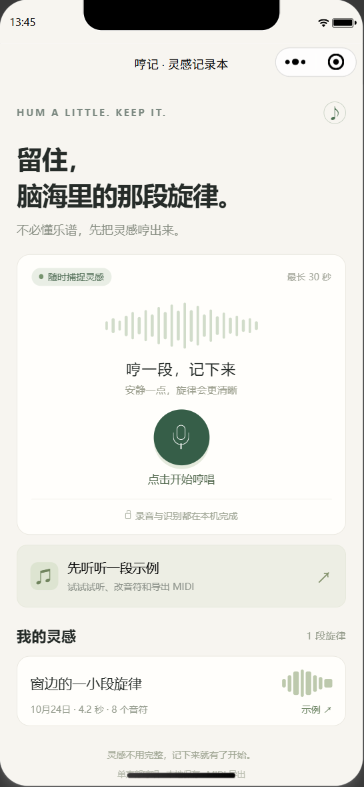
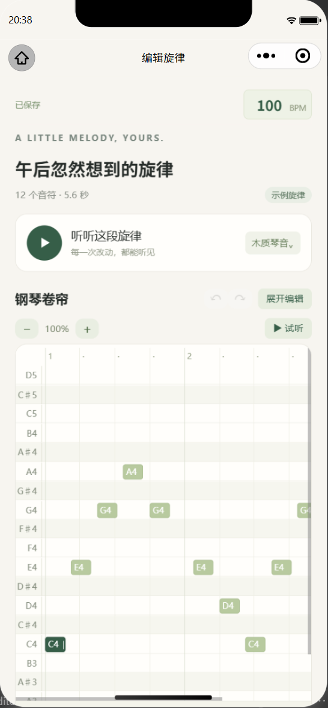
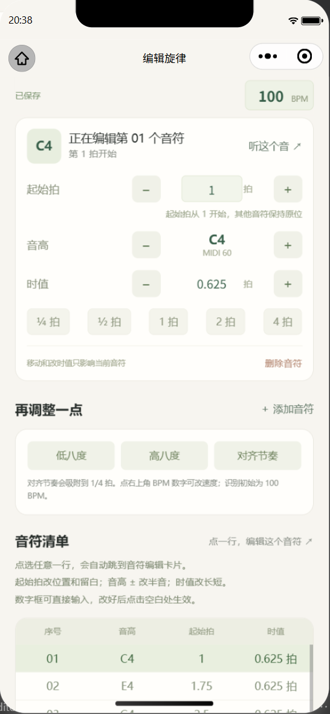
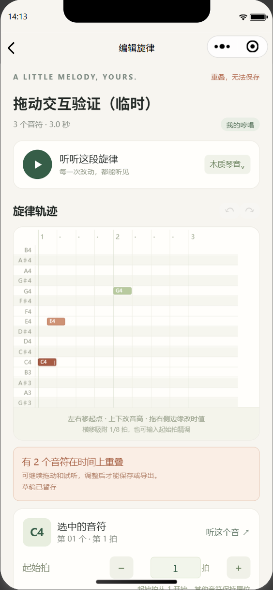
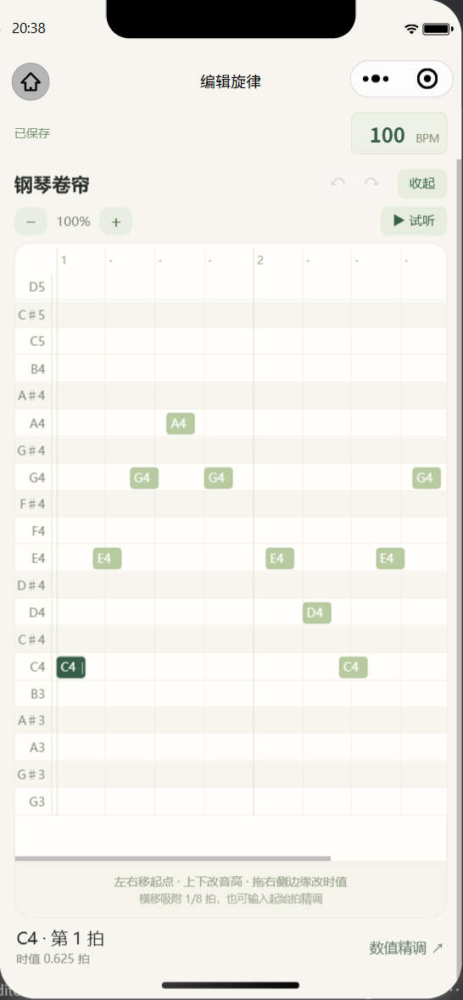

# 哼记原型验证记录

初始验证日期：2026 年 10 月 24 日；创作与音频分享更新验证：2026 年 10 月 25 日。

环境：Windows、微信开发者工具 Stable `2.02.2608080`、小程序基础库 `3.7.12`、Node.js `v24.19.0`。使用用户确认的 AppID 做本机调试。

## 结果

| 验证项 | 结果与证据 |
| --- | --- |
| 官方 CLI 接口 | `wechatide -c Codex` 完成首次授权；登录状态有效，skill 版本一致 |
| 工程导入与开窗 | `project_import` 成功，`open_project_window` 成功打开 `s0` 窗口 |
| 模板与样式 | 修正 WXML 表达式后官方 `compile_wxml` 成功；`compile_wxss` 成功；首页和编辑页均在模拟器运行 |
| 实际界面 | 逐页检查真实模拟器截图；修正微信 v2 默认按钮宽度造成的布局偏差；最终截图见下方 |
| 修改音高 | 实际点击升半音按钮，首音由 MIDI 60（C4）变为 61（C♯4） |
| 左右拖动 | 使用真实 `touchstart / touchmove / touchend` 将第二音从第 3 拍拖到第 1.5 拍；它保留在重叠位置，第三音零基起点保持 4 拍，没有自动推开 |
| 修改时值 | 实际编辑处理函数测试中，将第一音延长到 2.5 拍；后续音符保持原位，重叠可继续编辑 |
| 重叠提示与导出限制 | 冲突的两个音符变色；页面显示“重叠，无法保存”。实际点击导出后没有显示成功弹窗，也没有生成该条旋律的 MIDI 文件 |
| 草稿恢复与精确空拍 | 重叠布局单独保存为草稿，正式版本保持原有起点。离开重进恢复第 1.5 拍的编辑；输入第 3.375 拍后，前方留白为 1.375 拍，自动恢复保存并清除草稿 |
| 试听 | 模拟器已验证合成试听实际播放，音频实例报告 `paused: false`；试听波形与 BPM 时长测试通过 |
| 撤销与自动保存 | 测试验证撤销和重做可跨越重叠状态：重叠时只暂存草稿，合法布局恢复正式保存 |
| BPM 设置 | 通过输入框失焦事件改为 120 BPM，旋律时长从 4.2 秒变为 3.5 秒，音高不变；实际导出的 MIDI tempo 为每拍 500000 微秒，即 120 BPM。验证后恢复为默认 100 BPM，并突出显示 BPM 输入框 |
| 小程序内完整识别链路 | 程序生成 3 秒 16 kHz WAV，包含 C4、E4、G4，直接送入真实录音结束处理；正确得到 `[60,64,67]`，自动保存并进入编辑页，原始音频另存为 16 kHz WAV |
| 应用实际导出 | 从小程序文件系统取出实际导出的 `.mid`，独立解析验证：116 字节、格式 0、单轨、480 PPQ、100 BPM，8 个音符及其起点和时值正确，note on/off 全部配对 |
| 调整留白后的实际导出 | 解决重叠后重新导出，73 字节的 MIDI 独立解析得到 C4 起点 0、E4 起点 2.375、G4 起点 4，各长 1 拍；留白和其他音符位置完整保留 |
| 核心与编辑回归测试 | 最新 `npm test` 共 107 组命名检查通过，另有 2,712 帧逐值比对；包括原有功能及索引恢复、增量更新、试听缓存、创作变形、音频分享和页面集成 |
| 创作及音频分享 | 8 种预设、原曲/结果试听、应用后撤销、另存独立原录音及两种 WAV 准备已在模拟器验证，见 [创作与音频分享](创作与音频分享.md) |
| 真人录音离线保留评测 | 721 条验证录音选择配置，701 条测试录音与原版比较，均按作品宏平均；见 [真人哼唱评测摘要](HumTrans评测摘要.md) |
| 集成一致性 | 1,542 条缓存的生产分段与选定评测分段完全一致，另用 4 条完整 TRAIN 录音重跑音频链路一致 |
| 小程序内真人录音片段 | TRAIN 的 F01_0253_0002_2 前 2 秒重采样至 8 kHz，经解码、识别、保存进入编辑页，5 个输出音符与 Node 完全一致；验证后移除临时记录 |

性能优化前，约 30 秒合成旋律在该电脑的 Node 运行时约 1.3 秒完成识别；优化后的独立多轮 benchmark 约 15.8ms，微信模拟器解码、识别和保存整条链路约 642ms。不同测试覆盖的工作不同，不能直接混为手机耗时。完整口径与前后数据见 [性能优化报告](性能优化报告.md)。

本轮使用合成测试音频与已有数据集录音，未开启麦克风。临时生成的灵感和音频已清理。

## 根据真机反馈完成的修正

- **游标卡顿与不同步**：原来只依赖稀疏的 `onTimeUpdate`。现在由 `onPlay` 启动约 33ms 的更新，用实际 `currentTime` 校准并在回调之间插值；生成 WAV 时不提前启动，缓冲/暂停时冻结，停止/结束/销毁时清理。真实开发者工具播放约 2.2 秒的观察中，游标约每秒更新 30 次；末次显示时间为 2.160 秒，读取音频时间为 2.192 秒，相差约一个更新周期。此为模拟器结果，手机听感与流畅度仍需复测。
- **麦克风授权**：移除首次录音前无条件 `wx.authorize` 与“所有失败都打开设置”的处理。先完成隐私流程，再查询权限；未知状态交给真实 `RecorderManager.start` 发起授权，只有明确 `scope.record=false` 才提供小程序设置，微信系统麦克风拒绝走系统权限入口。隐私声明、用户拒绝、系统权限、占用及其他错误分别处理，保留原始错误信息；设置返回后重新检查。没有替用户同意或打开麦克风。只读模拟器查询为 `needAuthorization=false`、存在隐私指引名称、小程序录音 scope 尚未出现、系统麦克风 authorized；该结果不能代表用户手机或证明后台录音类型已正确声明。
- **编辑空间**：行距由 28rpx 增到 44rpx、音符高度由 22rpx 增到 36rpx；默认画布高度随屏幕增大，增加展开模式及 50%～200% 横向缩放。在 390px 宽、753px 窗口的模拟器中，展开后画布约 518px 高。125% 网格下横拖 26px 左移半拍：第二音从零基起点 0.75 移到 0.25，其他音符起点保持 0 和 1.5，重叠可暂存草稿并撤销。CLI 的 touchend 使用了默认中心点，最终触点通过实际页面处理函数明确传入；核心测试另验证松手最终坐标与缩放换算。
- **BPM 和清单**：BPM 移到右上角并随页面顶部保留；点击清单一行自动跳转至该音符的编辑卡片，提示分别说明起始拍/留白、半音调整、时值以及输入生效方式。
- **发送功能**：用户已在真机确认可用，本轮保留文件发送流程。

## 仍需手机验证

以下项目需要用户亲自在手机微信里完成：

1. 完成隐私与麦克风授权后，用真人哼唱验证采集、录音格式、识别准确率、耗时，以及来电/切后台的行为。
2. 复测新版播放游标与声音的对应关系，以及展开、缩放后的手机拖动手感。

微信 MIDI 发送已由用户验证通过；在目标编曲软件中的导入效果仍可继续检查。

已有真人数据集评测；手机采集与普通用户自然哼唱仍需另测。滑音、强颤音、气声、持续八度误判和精确起音仍可能需要手动修正。

## 实际界面

以下为微信开发者工具截图，不是设计稿。

首页：

旋律与音符编辑：

时值数值编辑（BPM 已移至右上角）：

横向移动后允许暂时重叠，并标出冲突、保留草稿：

扩大后的展开编辑模式：

